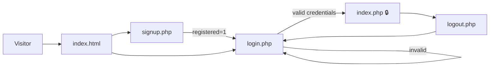
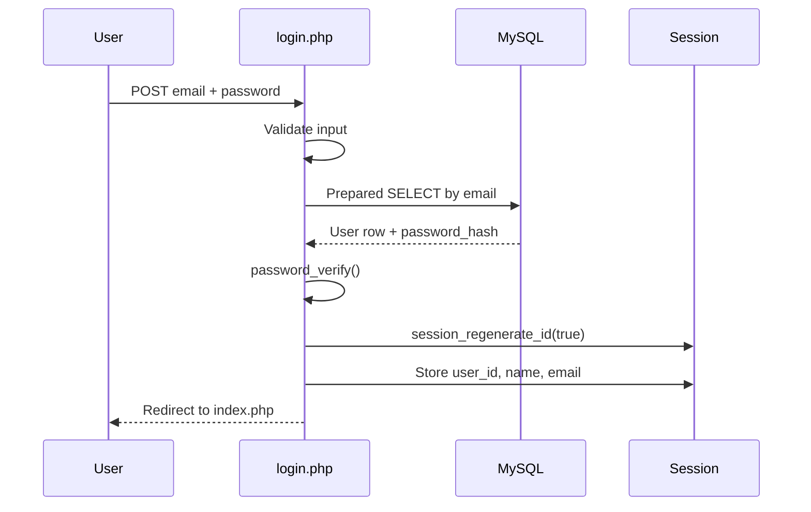

# 🌿 NutriWell

### *Eat Better. Live Better.*

> Nutrition science made plain, practical and trustworthy — learn the basics, cook with confidence, and build habits that last.

**[Overview](#-overview)** · **[Features](#-features)** · **[Quick Start](#-quick-start)** · **[Security](#-security)** · **[Contact](#-contact)**

| Layer | Technology |
|---|---|
| **Front end** | `HTML5` · `CSS3` · `Vanilla JavaScript` |
| **Back end** | `PHP 8` · `MySQL / MariaDB` |
| **Auth** | `password_hash()` · Prepared statements · Secure sessions |
| **Dependencies** | None on the front end — no frameworks, no build step |

---

## 📌 Overview

**NutriWell** turns nutrition science into plain, practical guidance. Visitors learn what protein, carbs, fats, vitamins and minerals do for the body, explore healthy foods, follow step-by-step recipes, check their BMI, and connect with a qualified dietitian — all in one clean, fast interface.

The project pairs a **framework-free front end** (semantic HTML5, modern CSS, vanilla JavaScript) with a **PHP + MySQL back end** that provides secure registration, login and session-protected pages. It was built for the **Web Technologies** course with a focus on real-world engineering practices: clean structure, accessibility, security and responsive design.

| | |
|---|---|
| **Audience** | People who want simple, trustworthy nutrition guidance |
| **Approach** | Learn the basics → make it practical → build habits that last |
| **Stack** | HTML5 · CSS3 · Vanilla JS · PHP 8 · MySQL |
| **Dependencies** | None on the front end (no frameworks, no build step) |

---

## ✨ Features

### 🎨 Experience
| Feature | Description |
|---|---|
| 🌗 **Dark / Light theme** | One-click toggle with a consistent palette across every page |
| 📱 **Fully responsive** | Fluid layouts using CSS Grid & Flexbox, with a mobile hamburger menu |
| 🎞️ **Micro-interactions** | Animated stat counters, accordions, smooth modals and hover states |
| ♿ **Accessible by design** | Semantic landmarks, ARIA attributes, keyboard-friendly controls, alt text |

### 🥗 Nutrition tools
| Feature | Description |
|---|---|
| 🔍 **Food Explorer** | Browse healthy foods and filter them by category in real time |
| 🍳 **Recipe Library** | 25+ recipes across 7 categories: Breakfast, Lunch, Dinner, Juices & Smoothies, Snacks, Salads, Desserts |
| 🪟 **Recipe Modal** | Full ingredient list, numbered preparation steps, time and difficulty |
| ⚖️ **BMI Calculator** | Validated height/weight inputs with instant category and guidance |
| 💡 **Daily Tips** | Rotating nutrition tips to keep content fresh |
| 📬 **Validated Forms** | Contact and newsletter forms with inline, field-level error messages |

### 🔐 Member system
| Feature | Description |
|---|---|
| 📝 **Sign Up** | Name, email and password validation with duplicate-email detection |
| 🔑 **Login** | Credential verification with session-ID regeneration |
| 🚪 **Logout** | Complete session and cookie teardown |
| 🛡️ **Protected Home** | `index.php` is accessible only to authenticated users |

### 👩‍⚕️ Expert-backed
A featured profile of **DN Mahnoor**, Dietitian & Nutritionist, gives visitors a direct route to personalised diet guidance for PCOS, diabetes and weight management.

---


---

## 🗺️ Site Map

| Page | File | Access | Purpose |
|---|---|---|---|
| Home | `index.html` | Public | Landing page with Login / Sign Up |
| Home (Members) | `index.php` | 🔒 Logged-in | Same experience with Logout |
| About | `about.html` | Public | Mission, 3-step approach, 4 core principles |
| Nutrition | `nutrition.html` | Public | Nutrient guide, Food Explorer, BMI calculator |
| Recipes | `recipes.html` | Public | Filterable recipe grid with detail modal |
| Contact | `contact.html` | Public | Contact form, details and expert profile |
| Sign Up | `signup.php` | Guests | Account registration |
| Login | `login.php` | Guests | Authentication |
| Logout | `logout.php` | 🔒 Logged-in | Ends session |

---

## 🏗️ Architecture

### User flow



### Request lifecycle (login)



### Folder structure

```
project-root/
├── database/
│   └── schema.sql            # Database & table definitions
├── config/
│   └── database.php          # mysqli connection ($conn)
├── includes/
│   └── session.php           # Session bootstrap
└── NutriWell/                # Public web root
    ├── index.html            # Public landing page
    ├── index.php             # Member home (session-protected)
    ├── about.html
    ├── nutrition.html
    ├── recipes.html
    ├── contact.html
    ├── login.php
    ├── signup.php
    ├── logout.php
    ├── css/
    │   └── style.css         # Design system & components
    ├── js/
    │   └── script.js         # Theme, nav, filters, BMI, modal, validation
    ├── images/
    │   └── expert/
    └── docs/
        └── screenshots/
```

> The PHP pages load `../config/database.php` and `../includes/session.php`, so those two folders must sit **one level above** the PHP pages.

---

## 🎨 Design System

| Token | Value | Usage |
|---|---|---|
| Forest | `#2f3d25` | Dark sections, expert and CTA cards |
| Moss | `#6a8a55` | Accents and dividers |
| Clay | `#c8653a` | Highlights and primary accents |
| Cream | `#f5f1e6` | Light section backgrounds |
| Heading font | **Fraunces** (serif) | Editorial, warm headings |
| Body font | **Manrope** (sans-serif) | Clean, readable body text |

Every page shares one header, footer and component library, so navigation and styling stay consistent from page to page.

---

## 🚀 Quick Start

### Prerequisites

- **PHP** 8.0 or newer
- **MySQL** 5.7+ or **MariaDB**
- A local stack such as **XAMPP**, **WAMP**, **MAMP** or **Laragon**

### 1 · Clone

```bash
git clone https://github.com/<your-username>/NutriWell.git
```

### 2 · Place in your web root

Copy the project into your server directory (for XAMPP: `C:/xampp/htdocs/`) and start **Apache** and **MySQL**.

### 3 · Create the database

Import the included schema from the project root:

```bash
mysql -u root -p < database/schema.sql
```

This creates the `nutriwell` database and the `users` table. Alternatively, import `database/schema.sql` through **phpMyAdmin → Import**.

### 4 · Configure the connection

`config/database.php`

```php
<?php
$conn = new mysqli('localhost', 'DB_USER', 'DB_PASSWORD', 'nutriwell');

if ($conn->connect_error) {
    die('Database connection failed.');
}

$conn->set_charset('utf8mb4');
```

`includes/session.php`

```php
<?php
if (session_status() === PHP_SESSION_NONE) {
    session_set_cookie_params([
        'httponly' => true,
        'samesite' => 'Lax',
    ]);
    session_start();
}
```

### 5 · Run

Open **http://localhost/NutriWell/index.html** in your browser.

> 💡 The static pages (About, Nutrition, Recipes, Contact) also work by opening the `.html` files directly. Only Sign Up, Login and Logout need PHP and MySQL.

> ⚠️ Never commit real credentials. Add `config/database.php` to `.gitignore`.

---

## 🗄️ Database Schema

The schema lives in [`database/schema.sql`](database/schema.sql) and targets **MySQL 5.7+ / MariaDB 10.3+**.

### `users`

Stores registered members. Passwords are never stored in plain text, only as hashes produced by PHP's `password_hash()`.

| Column | Type | Constraints | Description |
|---|---|---|---|
| `id` | `INT UNSIGNED` | PK, AUTO_INCREMENT | Unique user ID |
| `full_name` | `VARCHAR(100)` | NOT NULL | Member's full name |
| `email` | `VARCHAR(255)` | NOT NULL, UNIQUE (`uq_users_email`) | Login identifier, duplicates rejected |
| `password_hash` | `VARCHAR(255)` | NOT NULL | bcrypt/argon2 hash |
| `created_at` | `TIMESTAMP` | NOT NULL, DEFAULT `CURRENT_TIMESTAMP` | Registration time |

**Engine:** InnoDB · **Charset:** `utf8mb4` · **Collation:** `utf8mb4_unicode_ci`

<details>
<summary><b>View full schema.sql</b></summary>

```sql
-- ============================================================
-- NutriWell - Database Schema
-- Engine : MySQL 5.7+ / MariaDB 10.3+
-- Usage  : mysql -u root -p < database/schema.sql
-- ============================================================

CREATE DATABASE IF NOT EXISTS nutriwell
    CHARACTER SET utf8mb4
    COLLATE utf8mb4_unicode_ci;

USE nutriwell;

-- ------------------------------------------------------------
-- Table: users
-- Stores registered members. Passwords are stored only as
-- bcrypt/argon2 hashes produced by PHP's password_hash().
-- ------------------------------------------------------------
CREATE TABLE IF NOT EXISTS users (
    id            INT UNSIGNED  NOT NULL AUTO_INCREMENT,
    full_name     VARCHAR(100)  NOT NULL,
    email         VARCHAR(255)  NOT NULL,
    password_hash VARCHAR(255)  NOT NULL,
    created_at    TIMESTAMP     NOT NULL DEFAULT CURRENT_TIMESTAMP,

    PRIMARY KEY (id),
    UNIQUE KEY uq_users_email (email)
) ENGINE=InnoDB
  DEFAULT CHARSET=utf8mb4
  COLLATE=utf8mb4_unicode_ci;
```

</details>

---

## 🔒 Security

| Threat | Mitigation |
|---|---|
| Plain-text passwords | `password_hash()` with `PASSWORD_DEFAULT`, verified via `password_verify()` |
| SQL injection | Prepared statements with bound parameters on every query |
| Cross-site scripting | All dynamic output escaped with `htmlspecialchars()` |
| Session fixation | `session_regenerate_id(true)` on successful login |
| Session leftovers | Logout clears `$_SESSION`, expires the cookie and destroys the session |
| Cookie theft | `HttpOnly` and `SameSite` cookie flags |
| Bad input | Client-side (HTML5) **and** server-side validation |
| Account enumeration | Generic "Invalid email or password" message on failed login |
| Unauthorised access | `index.php` redirects guests to `login.php` |

---

## ✅ Testing Checklist

- [x] Register with valid details → redirected to login with success message
- [x] Register with an existing email → error shown
- [x] Register with mismatched or short passwords → error shown
- [x] Log in with wrong credentials → generic error, email preserved
- [x] Open `index.php` while logged out → redirected to login
- [x] Log out → session destroyed, back button does not restore access
- [x] Recipe and food filters update instantly
- [x] BMI calculator rejects empty, zero and negative values
- [x] Contact form shows inline errors, then a success message
- [x] Layout verified at mobile, tablet and desktop widths
- [x] Dark mode readable on every page

---

## 🧭 Roadmap

- [ ] Personal dashboard (saved recipes, BMI history)
- [ ] Contact form backend (database storage / email delivery)
- [ ] Password reset by email
- [ ] CSRF tokens on all forms
- [ ] Rate-limiting on login attempts
- [ ] Recipes and foods loaded from the database
- [ ] Multilingual support (English / Urdu)

---

## 👩‍⚕️ Featured Expert

<table>
<tr>
<td width="140" align="center">


</td>
<td>

**DN Mahnoor** — *Dietitian & Nutritionist*

Helps people with **PCOS**, **diabetes** and **weight management**, building personalised diet plans around real everyday life.

[Follow on Instagram → @dnmahnoor_01](https://www.instagram.com/dnmahnoor_01/)

</td>
</tr>
</table>

---

## 🎓 Academic Context

Developed for the **Web Technologies** course, demonstrating:

- Multi-page navigation and consistent UI/UX
- Responsive layout with CSS Grid, Flexbox and media queries
- DOM manipulation, events, validation and modals in JavaScript
- Server-side programming with PHP and MySQL
- Secure authentication and session management
- Git / GitHub version control and clean project structure

---

## ⚠️ Disclaimer

NutriWell provides general educational information and is **not a substitute for professional medical advice**. The BMI calculator is a screening tool only. Consult a qualified healthcare professional before making significant changes to your diet.

---

## 📬 Contact

| | |
|---|---|
| 📧 **Email** | ranaaliranaali09797@gmail.com |
| 📍 **Location** | Sargodha, Punjab, Pakistan |
| 🕙 **Hours** | Mon – Sat, 10 AM – 6 PM |
| 📸 **Instagram** | [@dnmahnoor_01](https://www.instagram.com/dnmahnoor_01/) |

---

### 🌿 NutriWell
*Eat Better. Live Better.*

Built with ❤️ using HTML, CSS, JavaScript, PHP & MySQL

© 2026 NutriWell. All rights reserved.
